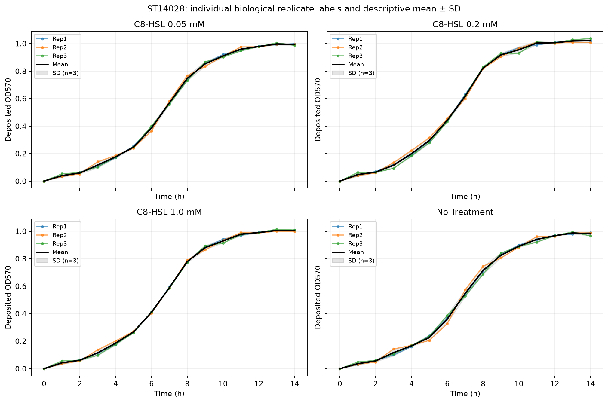
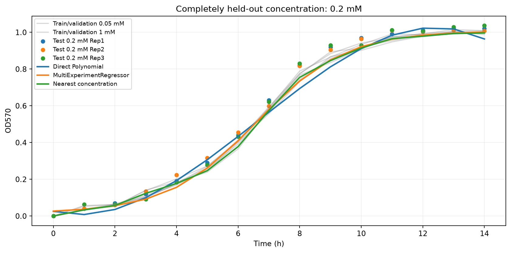

# Реальный эксперимент: рост ST14028

Воспроизводимый отчёт — {download}`real_bacterial_growth.ipynb <../examples/real_bacterial_growth.ipynb>`.
Ноутбук содержит выполненные ячейки, таблицы и восемь графиков. Использованы существующие
`ModelSelector`, `fit_family` и `MultiExperimentRegressor`; математическая библиотека не менялась.
Вспомогательный модуль отвечает за чтение, аудит, разбиения, вызовы API и baseline.

## Источник и воспроизведение

Ghosh, Anjali; Fernandes, Schnieder. *Data sets for Dissecting the Phenotypic Complexity
of Biofilm Development and Quorum Sensing in Salmonella enterica Serovars*,
[Zenodo, запись 22798201](https://zenodo.org/records/22798201), версия v5 от 16.09.2026,
[DOI 10.5281/zenodo.22798201](https://doi.org/10.5281/zenodo.22798201), лицензия CC-BY-4.0.
Дата получения: 08.11.2026. Метаданные записи сохранены рядом с оригиналом.

Файл: `data/external/Figure_2_multi_species_three_concentrations_linked (2).xlsx`.
[Прямая загрузка](https://zenodo.org/records/22798201/files/Figure_2_multi_species_three_concentrations_linked%20%282%29.xlsx?download=1).
Размер 375265 байт. MD5 совпадает с метаданными Zenodo:
`d1f9ac3ceadb1278e0e513c2ea32121a`.
SHA-256: `26450f3e8e0b834e384bbec308c537da65bc7afb61930f641036acc6932338a6`.

Из корня репозитория:

```powershell
uv sync --extra notebook --extra dev
uv run python examples/run_real_bacterial_growth.py
uv run python -m pytest -q
```

Либо открыть `uv run jupyter lab examples/real_bacterial_growth.ipynb` и выполнить
Restart Kernel and Run All. Для существующей `.venv` можно использовать напрямую
`.\.venv\Scripts\python.exe examples\run_real_bacterial_growth.py`.
Запуск использует CPU и seed=42. Оригинал уже включён в проект, сеть повторно не нужна.
Если оригинал отсутствует, загрузчик скачивает его. При ошибке предлагает вручную
сохранить файл по указанному пути. Другие наблюдения вместо него не генерируются.
Изменение контрольной суммы останавливает анализ и требует нового аудита.

Чтение XLSX реализовано узким читателем сохранённых значений OOXML (`zipfile` и
`xml.etree.ElementTree`). Формулы Excel не пересчитываются. Схема `Raw Data` проверяется;
все значения восьми листов дополнительно сверены с установленным `openpyxl` и совпали.
`openpyxl` не требуется для Run All. Точные версии библиотек сохраняются в
`artifacts/real_bacterial_growth/environment.json`; зависимости фиксирует `uv.lock`.

## Что фактически находится в файле

Описание записи сообщает об OD570, 37 °C, 150 rpm, трёх биологических повторах,
усреднении технических повторов, 12 точках 0–11 ч и соответствующих контролях растворителя.
Это сведения авторов из [метаданных Zenodo](https://zenodo.org/records/22798201).
Они не полностью согласуются с выбранным файлом.

Ниже — результаты непосредственного аудита Excel, а не предположения по описанию:

| Лист | Строк с заголовком | Столбцов | Назначение |
|---|---:|---:|---|
| Raw Data | 1261 | 5 | Индивидуальные наблюдения |
| Analysis Guide | 28 | 2 | Определения, обозначения повторов |
| Interval Calcs | 1261 | 11 | Производные расчёты |
| Replicate Metrics | 85 | 10 | Авторские AUC, lag и другие показатели |
| Descriptive Stats | 29 | 14 | Сводные показатели |
| Welch and Holm | 22 | 22 | Авторские статистические расчёты |
| Curve Summary | 421 | 8 | Средние кривые |
| Results Summary | 24 | 9 | Сводные результаты авторов |

Исходные столбцы: `Strain`, `Condition`, `Time (hrs)`, `Replicate`, `OD570`.
Семь кодов штаммов: ECOLI, PA, SE, ST14028, STTA1537, STWT, SV.
Четыре условия: No Treatment, C8-HSL 0.05 mM, C8-HSL 0.2 mM, C8-HSL 1.0 mM.
В каждом — Rep1/Rep2/Rep3, прямо обозначенные в Analysis Guide как биологические повторы.
Всего 84 кривые по **15 точек от 0 до 14 ч**; начальные OD570 везде равны **нулю**.
Файл не содержит отдельных технических повторов, blanks, дат или карты запусков.

Не установлено, являются ли значения уже background-corrected. Вторая коррекция не
производится; 0,05 к OD не прибавляется; точки 12–14 ч не удаляются.
No Treatment не переименован в vehicle control. Соответствие контролей, начального OD
и экспериментального периода требует уточнения у авторов. Совпадение контрольной суммы
подтверждает идентичность опубликованному файлу, но не разрешает эти противоречия.
Авторские производные метрики и p-values в моделирование или выводы о значимости не входят.

## Выбор и подготовка данных

Выбран ST14028: явно названный в описании штамм Salmonella, полный дизайн —
12 кривых, 180 наблюдений, без пропусков, дубликатов curve/time и отрицательных OD.
Полнота остальных штаммов тоже проверена; качество fit в выборе штамма не участвовало.
Не выполнялись удаление выбросов, сглаживание или усреднение повторов перед подбором.

`data/processed/bacterial_growth_all.csv` содержит все 1260 строк;
`data/processed/bacterial_growth.csv` — 180 строк ST14028.

| Поле | Смысл |
|---|---|
| curve_id | Штамм, исходное условие и метка повтора |
| experiment_id | Пусто: независимый ID запуска неизвестен |
| replicate_id / replicate_block | Исходная Rep-метка / штамм плюс Rep-метка |
| strain / source_condition | Исходные код штамма и условие |
| concentration_mM | Численная концентрация; номинально 0 для No Treatment |
| time_h / od570 | Время и опубликованное наблюдение без преобразований |
| is_control | Признак No Treatment |
| source_sheet / source_excel_row | Прослеживаемость до оригинала |
| background_correction | Явная отметка неизвестного статуса коррекции |

EDA показывает все повторы, среднее ± выборочное SD и конечные значения.
Средняя OD в 14 ч: контроль 0,9813; 0,05 мМ — 0,9933; 0,2 мМ — 1,0217;
1,0 мМ — 1,0057. Это описание файла; статистическая значимость и причинность не заявляются.



## A: отдельные кривые

Для каждой из 12 кривых: fit на 0–11 ч, validation на 12–14 ч.
Все семь кандидатов имеют одно разбиение; `max_nfev=2000`, `max_starts=12`.
Победитель определяется штатным правилом RMSE с допуском 1% в пользу простоты.
Это validation для выбора, а не независимая итоговая оценка выбранного победителя.

| Семейство | Успешных fit | Средняя validation MAE | Средняя validation RMSE |
|---|---:|---:|---:|
| Polynomial 1 | 12/12 | 0,190705 | 0,205730 |
| Polynomial 2 | 12/12 | 0,395764 | 0,417378 |
| Polynomial 3 | 12/12 | 0,067170 | 0,086292 |
| Exponential | 12/12 | 0,392789 | 0,416096 |
| Logistic | 12/12 | 0,016369 | 0,017003 |
| Gompertz | 12/12 | 0,040152 | 0,041072 |
| Rational saturation | 12/12 | 0,190705 | 0,205730 |

Логистика выбрана на 10 кривых, Гомпертц — на двух. Все 84 подбора формально успешны.
Но condition нормированного якобиана рационального насыщения достигает 4,17·10⁸:
успех оптимизатора не означает устойчивых коэффициентов. Для общего семейства
неустойчивые варианты исключены заранее заданным правилом полного ранга и condition < 1e8.
Все ошибки, включая R², коэффициенты, формулы и сообщения оптимизатора сохранены.

Средний validation R² логистики равен −36,93: в трёх точках почти постоянного плато
очень мала локальная дисперсия. Это не противоречит небольшой абсолютной ошибке и
показывает ограниченность R² на коротких хвостах. В ноутбуке есть графики fit и residuals
для заранее выбранного Rep1 при всех трёх treated-концентрациях, включая общее семейство.

## B: полностью исключённая концентрация

No Treatment исключён из регрессии по C, поскольку соответствие vehicle control неизвестно.
Номинальный ноль оставлен только в EDA и A. Основное разбиение:

| Раздел | Концентрации, мМ | Метки повторов | Кривых | Точек |
|---|---|---|---:|---:|
| Fit-train | 0,05; 1,0 | Rep1, Rep2 | 4 | 60 |
| Inner-validation | 0,05; 1,0 | Rep3 | 2 | 30 |
| Final test | 0,2 | Rep1, Rep2, Rep3 | 3 | 45 |

Общее семейство выбирается по средним хронологическим validation RMSE **только четырёх
fit-train кривых** из A. Требуются успешность и устойчивость на всех четырёх; при
близких результатах выбирается меньшая сложность. Результаты A по 0,2 мМ — отдельная
диагностика и в это решение не входят. Выбрана logistic, RMSE правила выбора 0,018940.

`MultiExperimentRegressor` подбирает логистические параметры заново по всем 15 точкам
каждой fit-train кривой, затем проверяет 16 сочетаний Constant/Linear по исходным OD
inner-validation. Quadratic по двум уникальным C не предлагается. Получено 16 успешных
комбинаций; выбрана модель с шестью коэффициентами второго уровня и validation RMSE
0,015364. Все четыре промежуточных fit используются; их condition 6,21–6,53.
Ни validation, ни test кривые внутри B индивидуально не подгоняются.

API не выполняет refit на train+validation. Все методы сравнения используют те же
60 fit-train точек и те же 30 validation точек. Это осознанное ограничение текущего
эксперимента: все шесть доступных для разработки кривых не объединяются после выбора.
Построчные split-ID сохранены. Для задачи новой концентрации Rep-метки могут пересекать
outer-разделение; расчётный `analysis_group = partition|replicate_block` это явно отражает.
Он не интерпретируется как доказанный независимый биологический эксперимент.

Baseline Direct Polynomial использует sklearn-масштабирование и полиномиальные признаки
общей степени 1/2/3. Показатель C ограничен единицей: по двум концентрациям дополнительные
чистые C²/C³ эффекты не идентифицируются. Степень выбирается только на validation;
выбрана 3 с validation RMSE 0,035537. Базис: 1, t, C, t², tC, t³, t²C в масштабированных
координатах. Nearest concentration — средняя fit-train кривая ближайшего уровня,
здесь 0,05 мМ. Тестовые наблюдения и их начальные значения не используются в прогнозе.

### Измеренные итоговые метрики



Все 45 тестовых точек, pooling без усреднения OD по повторам:

| Подход | Test MAE | Test RMSE | Test R² |
|---|---:|---:|---:|
| Direct Polynomial | 0,039077 | 0,052798 | 0,982661 |
| MultiExperimentRegressor | 0,034021 | 0,041107 | 0,989490 |
| Nearest concentration | 0,034000 | 0,041621 | 0,989225 |

Двухэтапная модель отдельно по биологическим меткам:

| Повтор | MAE | RMSE | R² |
|---|---:|---:|---:|
| Rep1 | 0,034177 | 0,039853 | 0,990162 |
| Rep2 | 0,035177 | 0,042275 | 0,988595 |
| Rep3 | 0,032710 | 0,041157 | 0,989682 |

Модель лучше прямого полинома в этом разбиении. Преимущество перед ближайшей
концентрацией по RMSE невелико; по MAE ближайшая концентрация чуть лучше.
Высокий общий R² отражает в том числе большой временной рост и не доказывает
точного восстановления концентрационного эффекта.

### Полученная формула

При t в часах, C в мМ; численные значения округлены:

\[
\widehat{OD}_{570}(t,C)=0.0172159293+
\frac{0.9879769364+0.0117204982C}
{1+\exp\{-0.6951561449[t-(6.6347315440-0.1436887121C)]\}}.
\]

Таким образом, c(C)=0,0172159293, k(C)=0,6951561449,
L(C)=0,9879769364+0,0117204982C, x0(C)=6,6347315440−0,1436887121C.
Полная формула API с сохранённым масштабированием и 12 значащими цифрами находится
в ноутбуке и `new_concentration_model.json`. Формула не условна по начальному наблюдению
теста. Проверенный диапазон: 0–14 ч, тест 0,2 мМ внутри [0,05; 1,0] мМ.

После фиксации модели выполнена отдельная диагностика общего логистического семейства
на всех шести нетестовых treated-кривых. Она не участвует в обучении B.
Среднее ± SD коэффициентов по трём Rep:

| C, мМ | c | L | k | x0 |
|---|---|---|---|---|
| 0,05 | 0,01806 ± 0,00376 | 0,98727 ± 0,00483 | 0,69171 ± 0,00572 | 6,63339 ± 0,01670 |
| 1,0 | 0,01842 ± 0,00259 | 0,99789 ± 0,00320 | 0,70340 ± 0,01788 | 6,50856 ± 0,03051 |

Разброс c больше разницы средних; сдвиг k сопоставим с разбросом при 1,0 мМ.
L и x0 различаются описательно. Это не тест значимости и не обоснование линейности
между двумя уровнями. Коэффициенты не приравниваются к механистическим параметрам роста.

## Условная проверка нового биологического повтора

Файл подтверждает тип Rep как биологический, но не связь одинаковых Rep между условиями.
Поэтому выполнена чувствительность к исключению метки сразу на **всех** treated-концентрациях,
без утверждения о подтверждённой независимости запусков. При test=Rep1/2/3 меньшая
из оставшихся меток — fit-train, большая — validation. Семейство и сложности выбираются
заново на разрешённых разделах. API не refit: фактически одна метка обучает,
вторая валидирует, третья тестирует; каждая содержит 45 точек. Constant/Linear сохранены
как заранее заданное ограничение сложности, несмотря на три уровня C.

| Исключённая метка | RMSE Direct Polynomial | RMSE MultiExperiment | RMSE Nearest |
|---|---:|---:|---:|
| Rep1 | 0,039244 | 0,021331 | 0,015881 |
| Rep2 | 0,038870 | 0,027460 | 0,015881 |
| Rep3 | 0,042273 | 0,023978 | 0,013219 |

Во всех трёх случаях выбранное общее семейство — logistic. Здесь средняя кривая
известной концентрации лучше параметризации. MAE и R² каждого метода также есть
в ноутбуке и отдельных CSV. Эти метрики не объединяются с тестом новой концентрации.

## Что проверено и что требует дальнейшей работы

Проверены загрузка реального оригинала, аудит и извлечение кривых, оба API регрессии,
хронологический выбор, выбор сложности по целевым OD, строгий holdout концентрации,
формула, диагностические графики, baseline и исключение Rep-меток.
Выполнен Run All: 9 кодовых ячеек без ошибок; PNG и результаты сохранены.
Полный набор тестов: **155 passed** (149 существующих и 6 новых); Ruff check и format
проходят. Новые проверки защищают контрольную сумму/схему, целостность разбиений и запрет
чтения held-out результатов при выборе общего семейства. Существующие алгоритмы не менялись.

Основные ограничения: противоречия метаданных и файла, неустановленная коррекция фона
и сопоставимость контроля, неизвестная карта запусков, два тренировочных C и три
повтора, отсутствие оценки неопределённости и учёта ошибки промежуточных параметров,
локальная нелинейная оптимизация, обусловленность, отсутствие штатного refit после
выбора сложности. Семейство выбирается по продолжению отдельных кривых, что не
обязательно оптимизирует качество обобщённой поверхности. Для будущих улучшений
полезны подтверждённые group-ID, дополнительные концентрации/повторы, неопределённость
параметров и явно реализованный refit-протокол. Проверка не подтверждает универсального
преимущества двухэтапной модели или биологического механизма действия вещества.
